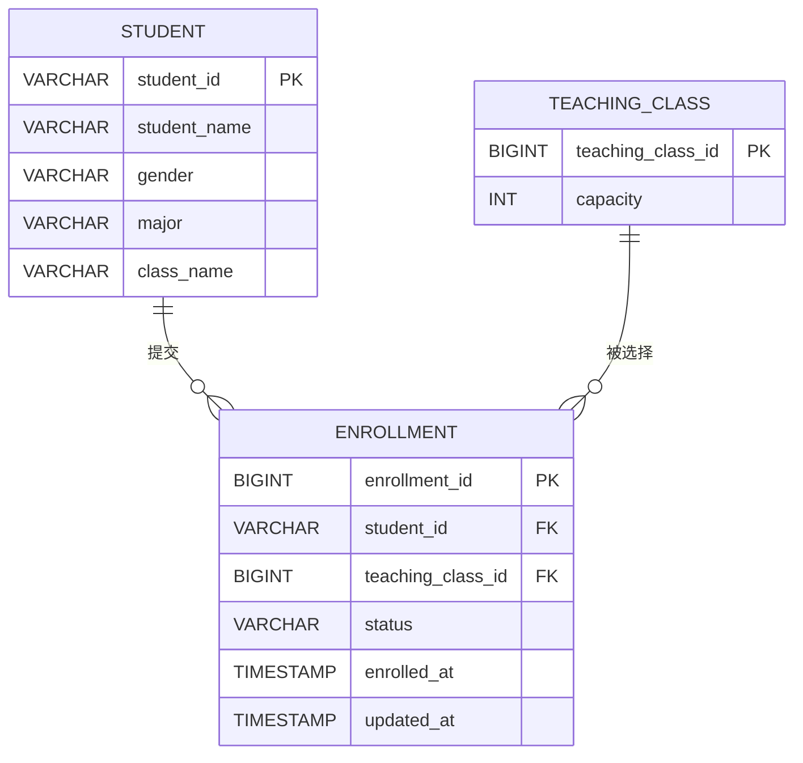

# 成员 A 设计说明：学生与选课

## 1. 业务需求

### 1.1 业务范围

本模块负责学生基本资料维护、学生选课与退课、课表查询和成绩查询。教师、课程、教学班维护及成绩录入由成员 B 负责，本模块只读取其结果。

### 1.2 用户角色与操作

学生角色的操作包括：

- 查询本人已选课程和课表。
- 选择尚有容量的教学班。
- 退出本人已选的教学班。
- 查询本人成绩，未录入时显示“未录入”。

系统管理人员可在本命令行程序中维护学生资料，包括新增、查询、修改和删除。

### 1.3 核心流程

选课时先确认学生和教学班存在，再检查是否重复以及教学班剩余容量。检查通过后新增选课记录；如果该学生此前已退课，则把原记录恢复为“已选”，避免同一学生与教学班出现多条历史记录。任一步骤失败均回滚。

退课时锁定相关教学班和选课记录，只允许把“已选”改为“已退”。重复退课或不存在的选课不修改数据。

### 1.4 明确需求、隐含需求与待确认需求

- 明确需求：学号为主键；选课号为主键；选课引用学生和教学班；不能重复选课；容量不足时拒绝选课。
- 隐含需求：删除有选课记录的学生时应保护历史数据；退课应保留记录而不是物理删除；并发选课不能超出容量。
- 待确认需求：是否存在跨课程的时间冲突、是否允许退课后再次选课、学期范围及具体上课周次。本版允许退课后重新选课，时间冲突留待教学班的排课字段确定后补充。

## 2. 业务规则与完整性约束

1. 学号唯一且非空，由 `student` 主键保证。
2. 学生姓名、专业、行政班非空；性别只能为男、女、未知。
3. 选课号和教学班号使用 `BIGINT`，选课号自增。
4. 每条选课必须引用已存在的学生和教学班，由外键保证。
5. `(student_id, teaching_class_id)` 唯一，从数据库层阻止同一学生重复选择同一教学班。
6. 状态只能为“已选”或“已退”，由 `CHECK` 保证。
7. 有效选课人数不得超过教学班容量，由 Service 事务和 `SELECT ... FOR UPDATE` 共同保证，单表 `CHECK` 无法替代此业务检查。
8. 有选课记录的学生不能直接删除，采用 `ON DELETE RESTRICT`，避免孤立选课数据。

## 3. 概念结构设计

学生与教学班在业务上是多对多联系：一名学生可选择多个教学班，一个教学班可有多名学生。`ENROLLMENT` 是该多对多联系的关联实体，同时保存状态和时间等联系属性。

候选主键：学生实体的候选键为 `student_id`；选课实体的候选键为 `enrollment_id`，同时 `(student_id, teaching_class_id)` 因唯一且非空也是候选键。

## 4. 逻辑结构设计

### STUDENT

`STUDENT(student_id PK, student_name, gender, major, class_name)`

### ENROLLMENT

`ENROLLMENT(enrollment_id PK, student_id FK, teaching_class_id FK, status, enrolled_at, updated_at)`

- 外键 `student_id` 引用 `STUDENT(student_id)`。
- 外键 `teaching_class_id` 引用成员 B 的 `TEACHING_CLASS(teaching_class_id)`。
- 替代键为 `(student_id, teaching_class_id)`。

## 5. 函数依赖与 3NF 分析

### 5.1 STUDENT

主要函数依赖：

- `student_id → student_name, gender, major, class_name`

分析：

- 1NF：姓名、性别、专业和行政班均按原子值保存，不保存多值列表。
- 2NF：候选键只有一个属性，不存在非主属性对复合主键的部分依赖。
- 3NF：`student_id` 是候选键；在本模块业务语义中，`class_name` 不决定 `major`，专业和行政班都只是学生的描述属性，不存在需要另行拆表的传递依赖。
- 结论：满足 3NF，不需要分解。新增学生必须提供必要资料属于业务完整性要求，不是规范化异常。

### 5.2 ENROLLMENT

主要函数依赖：

- `enrollment_id → student_id, teaching_class_id, status, enrolled_at, updated_at`
- `(student_id, teaching_class_id) → enrollment_id, status, enrolled_at, updated_at`

第二组依赖成立是因为业务禁止同一学生对同一教学班产生多条记录，并由唯一约束落实。

分析：

- 1NF：每条记录只描述一次选课，状态和时间都是单值。
- 2NF：两个候选键都能决定全部非主属性；使用复合候选键查询时不存在只依赖学号或只依赖教学班号的非主属性。
- 3NF：所有决定因素要么是候选键，要么其右侧为主属性；容量属于教学班而不是选课，课程名称也不冗余保存在选课表中，因此不存在非主属性传递依赖。
- 结论：满足 3NF，不需要分解。全部函数依赖保留在原关系中，未进行分解，因此不会引入有损连接或依赖丢失。

## 6. 物理设计与索引依据

- `uk_enrollment_student_class(student_id, teaching_class_id)`：同时承担防重复约束和学生选课查询索引。
- `idx_enrollment_class_status(teaching_class_id, status)`：选课时按教学班统计“已选”人数，可减少扫描无关记录。
- 两张表使用 InnoDB，保证外键、事务提交和回滚可用。
- 字符集使用 `utf8mb4`，支持中文姓名和状态。

## 7. 与成员 B 的只读接口

以下结构由 B 创建和维护，A 不代建：

| 表 | A 使用的字段 | 用途 |
|---|---|---|
| teaching_class | teaching_class_id BIGINT、course_id、capacity INT | 外键、容量检查、关联课程 |
| course | course_id、course_name | 课表及成绩查询显示课程名 |
| grade | enrollment_id BIGINT、score DECIMAL、is_recorded | 学生成绩查询 |

B 的 `grade.enrollment_id` 必须引用 A 的 `enrollment.enrollment_id`。如果 B 调整字段名或类型，双方必须同步修改连接查询和 README，不能单方面变更。
